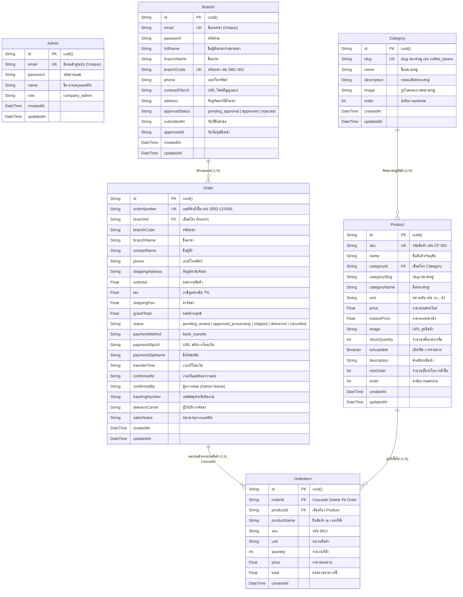
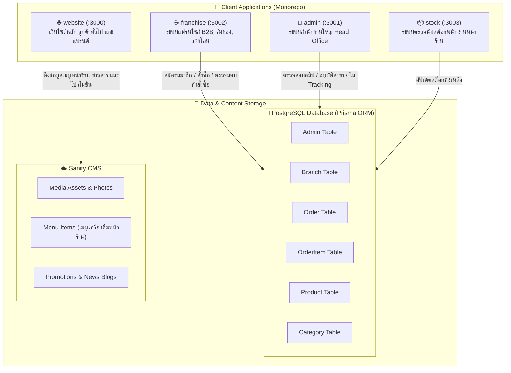
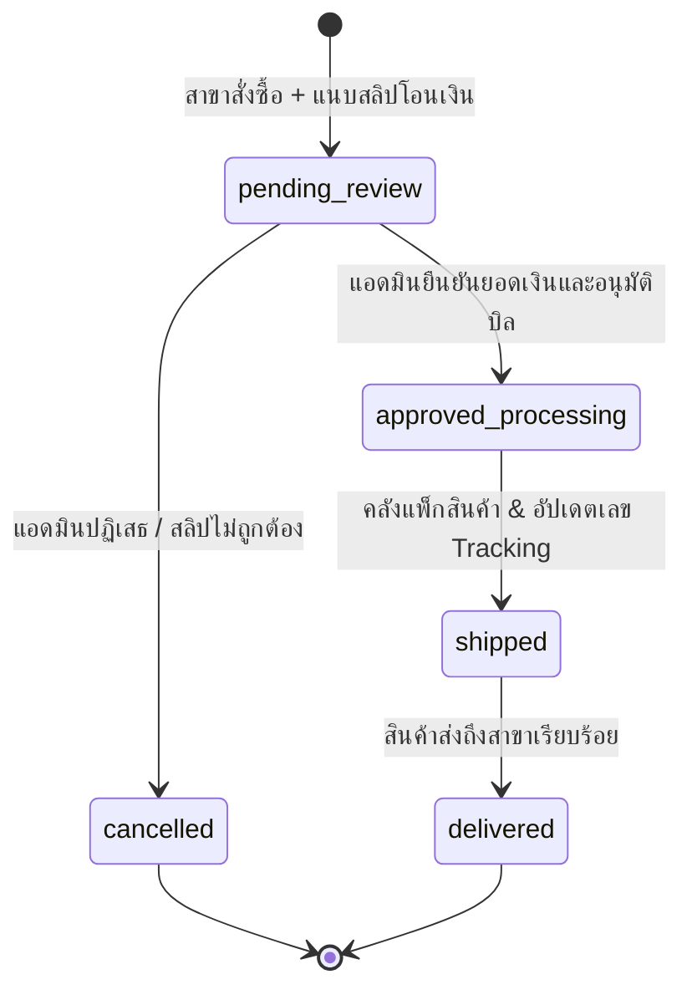

# Super Black Coffee - Database Schema & Architecture Diagrams

เอกสารสรุปการออกแบบฐานข้อมูล โครงสร้างโมเดล ความสัมพันธ์ของข้อมูล (ERD) และไดอะแกรมระบบทั้งหมดของโปรเจกต์ **Super Black Coffee**

---

## 1. Entity Relationship Diagram (ERD)



---

## 2. System Architecture & Data Flow Diagram



---

## 3. Order Lifecycle State Diagram



---

## 4. ตารางพจนานุกรมข้อมูล (Data Dictionary)

### 4.1 ตาราง `Admin` (ผู้ดูแลระบบสำนักงานใหญ่)
| ฟิลด์ (Field) | ชนิดข้อมูล (Type) | คีย์ (Key) | คำอธิบาย (Description) |
|---|---|---|---|
| `id` | `String` | PK | Primary Key (`cuid()`) |
| `email` | `String` | Unique | อีเมลสำหรับ Login |
| `password` | `String` | - | รหัสผ่านแฮช |
| `name` | `String` | - | ชื่อ-นามสกุล ผู้ดูแลระบบ |
| `role` | `String` | - | สิทธิ์การใช้งาน (`company_admin`) |
| `createdAt` | `DateTime` | - | วันเวลาที่สร้างข้อมูล |
| `updatedAt` | `DateTime` | - | วันเวลาที่อัปเดตล่าสุด |

### 4.2 ตาราง `Branch` (สาขาและสมาชิกแฟรนไชส์)
| ฟิลด์ (Field) | ชนิดข้อมูล (Type) | คีย์ (Key) | คำอธิบาย (Description) |
|---|---|---|---|
| `id` | `String` | PK | Primary Key (`cuid()`) |
| `email` | `String` | Unique | อีเมลสาขา |
| `password` | `String?` | - | รหัสผ่าน (Nullable) |
| `fullName` | `String` | - | ชื่อผู้จดทะเบียน/ผู้ดูแลสาขา |
| `branchName` | `String` | - | ชื่อสาขา เช่น สาขาอารีย์ |
| `branchCode` | `String` | Unique | รหัสสาขา เช่น `SBC-001` |
| `phone` | `String` | - | เบอร์โทรศัพท์ติดต่อ |
| `contractFileUrl`| `String?` | - | URL ไฟล์สัญญาแนบ |
| `address` | `String?` | - | ที่อยู่จัดส่งของสาขา |
| `approvalStatus` | `String` | - | สถานะ (`pending_approval`, `approved`, `rejected`) |
| `submittedAt` | `String?` | - | วันเวลาที่ยื่นขอแฟรนไชส์ |
| `approvedAt` | `String?` | - | วันเวลาที่ได้รับการอนุมัติ |
| `createdAt` | `DateTime` | - | วันเวลาที่สร้าง |
| `updatedAt` | `DateTime` | - | วันเวลาที่อัปเดต |

### 4.3 ตาราง `Category` (หมวดหมู่วัตถุดิบ/สินค้า)
| ฟิลด์ (Field) | ชนิดข้อมูล (Type) | คีย์ (Key) | คำอธิบาย (Description) |
|---|---|---|---|
| `id` | `String` | PK | Primary Key (`cuid()`) |
| `slug` | `String` | Unique | Slug อ้างอิง เช่น `coffee_beans`, `syrups_sauces` |
| `name` | `String` | - | ชื่อหมวดหมู่ภาษาไทย เช่น เมล็ดกาแฟ, ไซรัป |
| `description` | `String?` | - | คำอธิบาย |
| `image` | `String?` | - | รูปภาพหมวดหมู่ |
| `order` | `Int` | - | ลำดับการแสดงผล |
| `createdAt` | `DateTime` | - | วันเวลาที่สร้าง |
| `updatedAt` | `DateTime` | - | วันเวลาที่อัปเดต |

### 4.4 ตาราง `Product` (สินค้าและวัตถุดิบ)
| ฟิลด์ (Field) | ชนิดข้อมูล (Type) | คีย์ (Key) | คำอธิบาย (Description) |
|---|---|---|---|
| `id` | `String` | PK | Primary Key (`cuid()`) |
| `sku` | `String` | Unique | รหัสสินค้า SKU เช่น `CF-001` |
| `name` | `String` | - | ชื่อสินค้า |
| `categoryId` | `String?` | FK | เชื่อมโยง `Category.id` |
| `categorySlug` | `String` | - | สลักหมวดหมู่เริ่มต้น |
| `categoryName` | `String` | - | ชื่อหมวดหมู่ภาษาไทย |
| `unit` | `String` | - | หน่วยนับ เช่น ถุง (500g), ลัง, ขวด |
| `price` | `Float` | - | ราคาส่งสำหรับแฟรนไชส์ |
| `marketPrice` | `Float` | - | ราคาตลาดทั่วไป |
| `image` | `String` | - | URL รูปสินค้า |
| `stockQuantity` | `Int` | - | จำนวนคงเหลือในคลัง |
| `isAvailable` | `Boolean` | - | สถานะพร้อมจำหน่าย (true/false) |
| `description` | `String?` | - | รายละเอียดสินค้า |
| `minOrder` | `Int?` | - | จำนวนสั่งซื้อขั้นต่ำ |
| `order` | `Int` | - | ลำดับการแสดงผล |
| `createdAt` | `DateTime` | - | วันเวลาที่สร้าง |
| `updatedAt` | `DateTime` | - | วันเวลาที่อัปเดต |

### 4.5 ตาราง `Order` (คำสั่งซื้อสินค้าของสาขา)
| ฟิลด์ (Field) | ชนิดข้อมูล (Type) | คีย์ (Key) | คำอธิบาย (Description) |
|---|---|---|---|
| `id` | `String` | PK | Primary Key (`cuid()`) |
| `orderNumber` | `String` | Unique | เลขที่เอกสารสั่งซื้อ เช่น `ORD-982134` |
| `branchId` | `String?` | FK | เชื่อมโยง `Branch.id` |
| `branchCode` | `String` | - | รหัสสาขา |
| `branchName` | `String` | - | ชื่อสาขา |
| `contactName` | `String` | - | ชื่อผู้รับสินค้า |
| `phone` | `String` | - | เบอร์ติดต่อปลายทาง |
| `shippingAddress` | `String` | - | ที่อยู่จัดส่งสินค้า |
| `subtotal` | `Float` | - | ยอดรวมสินค้าก่อนภาษี/ค่าส่ง |
| `tax` | `Float` | - | ภาษีมูลค่าเพิ่ม (VAT 7%) |
| `shippingFee` | `Float` | - | ค่าบริการจัดส่ง |
| `grandTotal` | `Float` | - | ยอดเงินรวมทั้งสิ้น |
| `status` | `String` | - | สถานะออเดอร์ (`pending_review`, `approved_processing`, `shipped`, `delivered`, `cancelled`) |
| `paymentMethod` | `String` | - | วิธีการชำระเงิน (`bank_transfer`) |
| `paymentSlipUrl` | `String` | - | URL สลิปหลักฐานการโอน |
| `paymentSlipName`| `String?` | - | ชื่อไฟล์สลิป |
| `transferTime` | `String?` | - | วันเวลาที่โอนเงิน |
| `confirmedAt` | `String?` | - | วันเวลาที่แอดมินยืนยัน |
| `confirmedBy` | `String?` | - | ชื่อหรือ ID แอดมินที่ยืนยัน |
| `trackingNumber` | `String?` | - | หมายเลขติดตามพัสดุ |
| `deliveryCarrier`| `String?` | - | บริษัทจัดส่ง เช่น Kerry, Flash |
| `salesNotes` | `String?` | - | บันทึกช่วยจำภายในสำหรับแอดมิน |
| `createdAt` | `DateTime` | - | วันเวลาที่สร้างคำสั่งซื้อ |
| `updatedAt` | `DateTime` | - | วันเวลาที่อัปเดตล่าสุด |

### 4.6 ตาราง `OrderItem` (รายการสินค้าภายในคำสั่งซื้อ)
| ฟิลด์ (Field) | ชนิดข้อมูล (Type) | คีย์ (Key) | คำอธิบาย (Description) |
|---|---|---|---|
| `id` | `String` | PK | Primary Key (`cuid()`) |
| `orderId` | `String` | FK | เชื่อมโยง `Order.id` (OnDelete: Cascade) |
| `productId` | `String?` | FK | เชื่อมโยง `Product.id` |
| `productName` | `String` | - | ชื่อสินค้า ณ ขณะสั่งซื้อ |
| `sku` | `String` | - | SKU ของสินค้า |
| `unit` | `String` | - | หน่วยนับ |
| `quantity` | `Int` | - | จำนวนที่สั่ง |
| `price` | `Float` | - | ราคาต่อหน่วย ณ ขณะสั่งซื้อ |
| `total` | `Float` | - | ยอดรวมของรายการนี้ (`quantity * price`) |
| `createdAt` | `DateTime` | - | วันเวลาที่สร้างรายการ |

---

## 5. Schema Definition File (`schema.prisma`)

```prisma
generator client {
  provider = "prisma-client-js"
}

datasource db {
  provider = "postgresql"
  url      = env("DATABASE_URL")
}

model Admin {
  id        String   @id @default(cuid())
  email     String   @unique
  password  String
  name      String
  role      String   @default("company_admin")
  createdAt DateTime @default(now())
  updatedAt DateTime @updatedAt
}

model Category {
  id          String    @id @default(cuid())
  slug        String    @unique
  name        String
  description String?
  image       String?
  order       Int       @default(0)
  products    Product[]
  createdAt   DateTime  @default(now())
  updatedAt   DateTime  @updatedAt
}

model Product {
  id             String      @id @default(cuid())
  sku            String      @unique
  name           String
  categoryId     String?
  category       Category?   @relation(fields: [categoryId], references: [id])
  categorySlug   String      @default("coffee_beans")
  categoryName   String      @default("เมล็ดกาแฟ")
  unit           String
  price          Float
  marketPrice    Float
  image          String
  stockQuantity  Int         @default(100)
  isAvailable    Boolean     @default(true)
  description    String?
  minOrder       Int?        @default(1)
  order          Int         @default(0)
  orderItems     OrderItem[]
  createdAt      DateTime    @default(now())
  updatedAt      DateTime    @updatedAt
}

model Branch {
  id              String   @id @default(cuid())
  email           String   @unique
  password        String?
  fullName        String
  branchName      String
  branchCode      String   @unique
  phone           String
  contractFileUrl String?
  address         String?
  approvalStatus  String   @default("pending_approval")
  submittedAt     String?
  approvedAt      String?
  orders          Order[]
  createdAt       DateTime @default(now())
  updatedAt       DateTime @updatedAt
}

model Order {
  id              String      @id @default(cuid())
  orderNumber     String      @unique
  branchId        String?
  branch          Branch?     @relation(fields: [branchId], references: [id])
  branchCode      String
  branchName      String
  contactName     String
  phone           String
  shippingAddress String
  subtotal        Float
  tax             Float
  shippingFee     Float
  grandTotal      Float
  status          String      @default("pending_review")
  paymentMethod   String      @default("bank_transfer")
  paymentSlipUrl  String
  paymentSlipName String?
  transferTime    String?
  confirmedAt     String?
  confirmedBy     String?
  trackingNumber  String?
  deliveryCarrier String?
  salesNotes      String?
  items           OrderItem[]
  createdAt       DateTime    @default(now())
  updatedAt       DateTime    @updatedAt
}

model OrderItem {
  id          String   @id @default(cuid())
  orderId     String
  order       Order    @relation(fields: [orderId], references: [id], onDelete: Cascade)
  productId   String?
  product     Product? @relation(fields: [productId], references: [id])
  productName String
  sku         String
  unit        String
  quantity    Int
  price       Float
  total       Float
  createdAt   DateTime @default(now())
}
```
