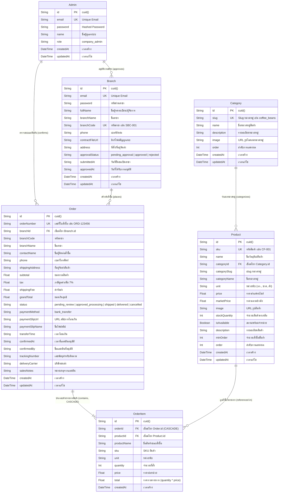
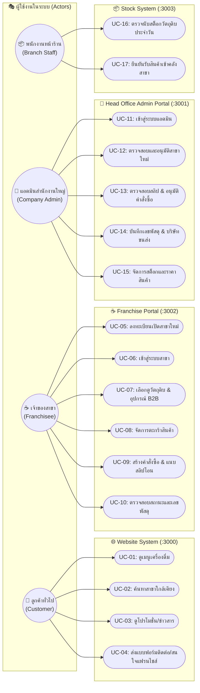
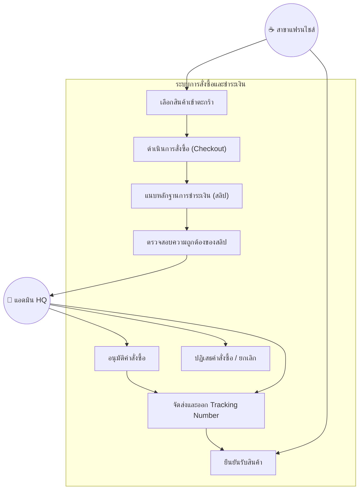
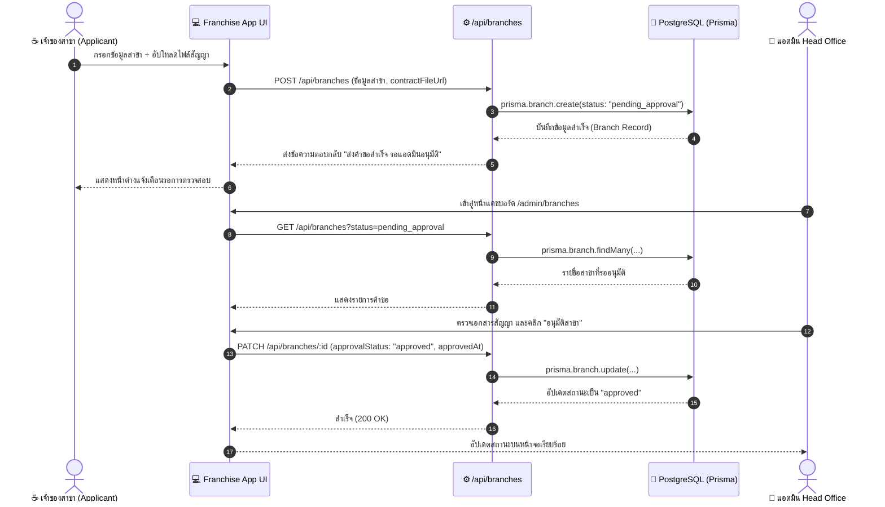
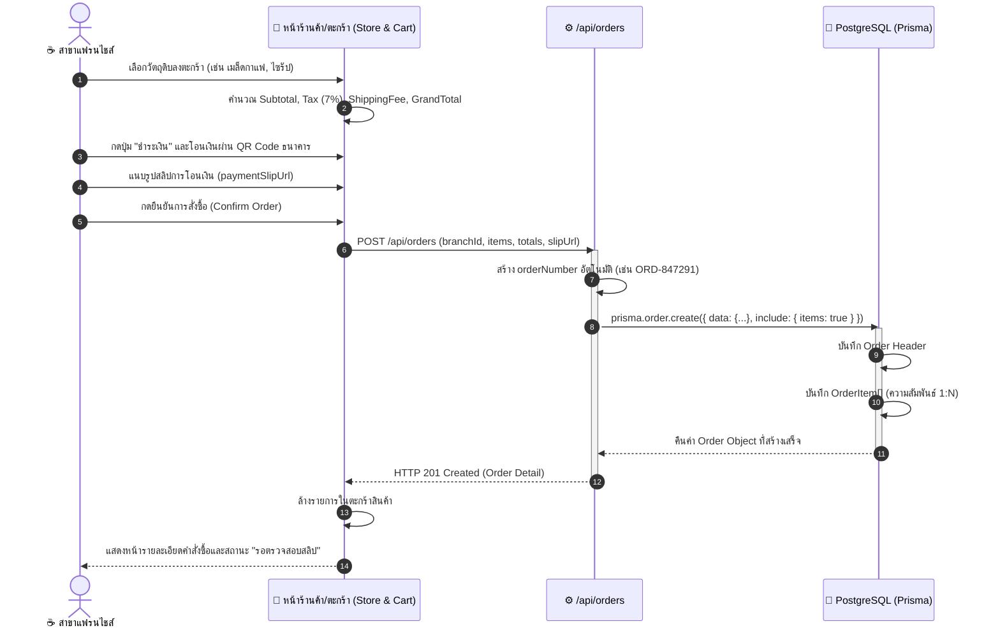
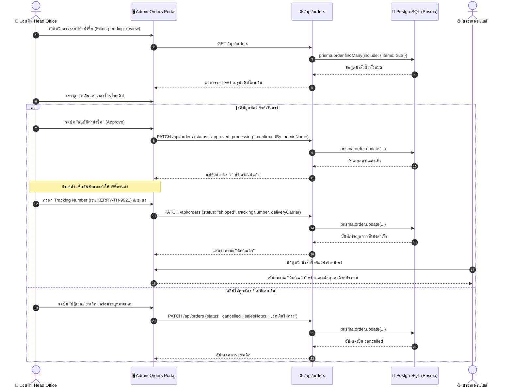

# Super Black Coffee - Software Engineering Diagrams & Specifications

เอกสารรวบรวมไดอะแกรมการวิเคราะห์และออกแบบระบบ (System Analysis & Design) ครบถ้วนตามมาตรฐานวิศวกรรมซอฟต์แวร์ ประกอบด้วย:
1. **ERD Diagram (Entity Relationship Diagram)**
2. **Use Case Diagram & Specifications**
3. **Sequence Diagrams (ลำดับเหตุการณ์การทำงานสำคัญ)**
4. **Data Dictionary & Schema Definitions**

---

## 1. Entity Relationship Diagram (ERD)

ไดอะแกรมแสดงโครงสร้าง Entity, Attributes, Keys และความสัมพันธ์ (Cardinality) ของระบบฐานข้อมูล PostgreSQL

---

## 2. Use Case Diagrams

### 2.1 Use Case ภาพรวมทั้งระบบ (System Overview)

### 2.2 Use Case รายละเอียด: การสั่งซื้อและจัดส่งสินค้า B2B

---

## 3. Sequence Diagrams (ไดอะแกรมแสดงลำดับเหตุการณ์)

### 3.1 Sequence Diagram: กระบวนการลงทะเบียนและอนุมัติสาขาใหม่ (Branch Registration & Approval)

---

### 3.2 Sequence Diagram: กระบวนการสั่งซื้อสินค้าและอัปโหลดสลิป (Order Creation & Payment Slip)

---

### 3.3 Sequence Diagram: กระบวนการตรวจสอบสลิปและจัดส่งสินค้า (Order Verification & Fulfillment)

---

## 4. สรุปความสอดคล้องของระบบ (System Matrix)

| Entity / Use Case | App ที่รับผิดชอบ | เทคโนโลยีจัดเก็บ | สถานะหลักที่เกี่ยวข้อง |
|---|---|---|---|
| **การสมัครและข้อมูลสาขา** | `apps/franchise` (UI), `apps/admin` (ตรวจ) | PostgreSQL (`Branch`) | `pending_approval`, `approved`, `rejected` |
| **แคตตาล็อกสินค้า B2B** | `apps/franchise`, `apps/admin` | PostgreSQL (`Product`, `Category`) | `isAvailable: true/false` |
| **การสั่งซื้อ & ชำระเงิน** | `apps/franchise` | PostgreSQL (`Order`, `OrderItem`) | `pending_review` |
| **การอนุมัติและจัดส่ง** | `apps/admin` | PostgreSQL (`Order`) | `approved_processing`, `shipped`, `delivered` |
| **เมนูเครื่องดื่มหน้าร้าน** | `apps/website` | Sanity CMS (`menuItem`) | เผยแพร่ผ่าน CDN |
| **การนับสต็อกสาขา** | `apps/stock` | PostgreSQL (`Product` stock sync) | อัปเดตจำนวนคงเหลือ |
